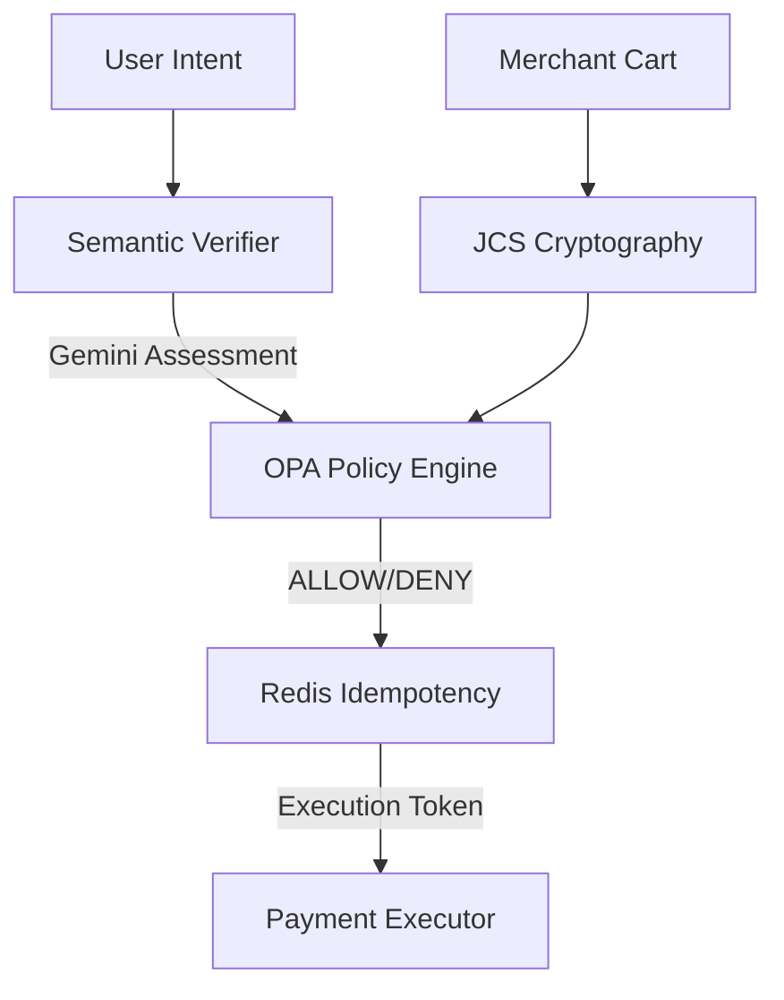

# VILR: Verifiable Intent & Liability Runtime

**VILR is a runtime trust boundary for agentic payments: AI interprets intent, cryptography verifies integrity, OPA authorizes deterministically, Redis protects execution, and only the payment executor can move money.**

## 1. The Problem
AI agents hallucinate, and merchants can inject malicious prompts, making autonomous AI payments extremely dangerous if the AI has the authority to move money.

## 2. The Solution
Separate intelligence from authorization: use AI to interpret intent, but use a deterministic, zero-trust cryptographic gateway to authorize the actual financial execution.

## 3. Architecture



## 4. Key Invariant
**AI can interpret and recommend. AI cannot authorize money movement.**
The Gemini LLM provides probabilistic semantic evidence; Open Policy Agent (OPA) evaluates that evidence deterministically.

## 5. 90-Second Quickstart
```bash
# Clone and setup
git clone https://github.com/sahvendraz/VILR.git
cd VILR
python3 -m venv venv && source venv/bin/activate
pip install -e .

# Run the live Gemini Productization Demo
# (Requires GEMINI_API_KEY in .env)
python scripts/cli.py demo --llm gemini
```

## 6. Security Evidence
In our rigorous security benchmark testing (40 attack vectors covering cart tampering, replay attacks, concurrent double-spends, and semantic manipulation):
- **0 unauthorized payments were executed.**
- 16 attacks were deterministically blocked by Gateway layers (Crypto, Redis, OPA).
- Semantic mismatch and prompt injections were consistently mitigated without overriding OPA budgets.

## 7. Gemini Integration
VILR integrates the official `google-genai` SDK using `gemini-3.6-flash`. It utilizes strict structured outputs (JSON schema) and securely fails closed on timeouts or schema violations. Gemini acts as an independent semantic assessor (evidence provider), remaining strictly subordinate to OPA.

## 8. Limitations & Scope
- **Prototype Status**: VILR is a Razorpay Buildathon prototype.
- **Mock Razorpay**: Currently executes against a simulated Razorpay payment executor.
- **AP2-Compatible**: The cryptography simulates the Advanced Payments 2.0 (AP2) specification concepts but is a lightweight representation, not a compliant implementation.
- **Simulated Recovery**: The revenue recovery metrics shown in the demo are conceptually simulated to demonstrate potential ROI.

For detailed architecture, security models, and performance benchmarks, see the `docs/` directory.
