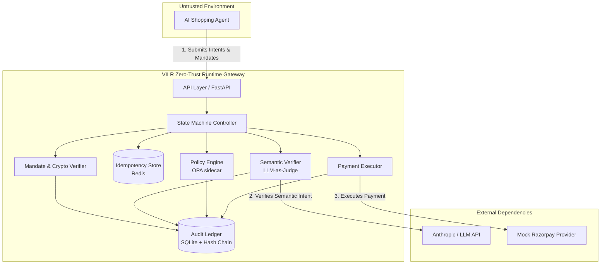
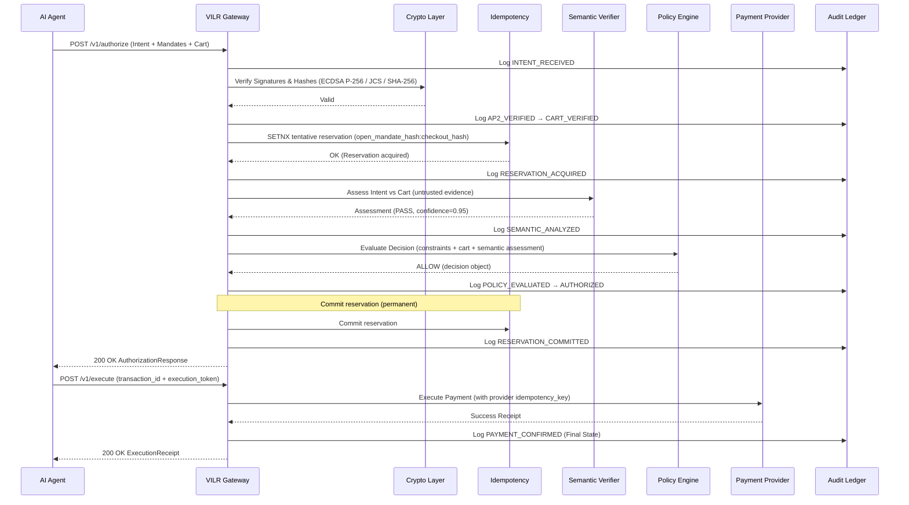
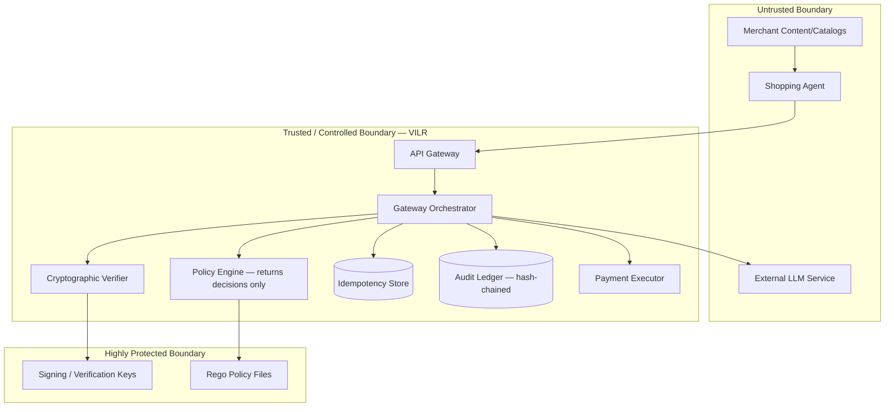
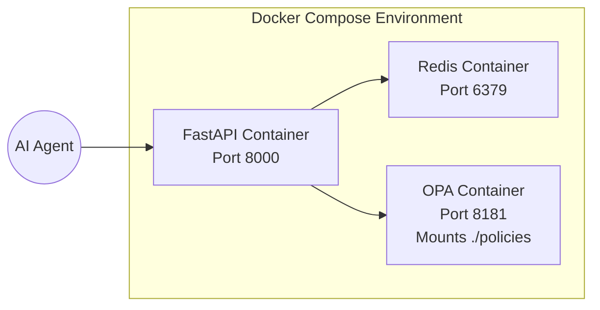

# VILR 2.0 Architecture

## 1. Overview
VILR is a zero-trust runtime transaction-integrity gateway positioned between AI shopping agents and payment providers (like Razorpay). It adds semantic intent verification and deterministic policy enforcement around cryptographically verifiable agentic transactions. By combining cryptographic integrity, semantic intelligence, and deterministic policy evaluation, VILR ensures that AI agents only execute transactions aligned with explicit user intent and hard-coded business rules.

> [!IMPORTANT]
> VILR is **not** a replacement for AP2, Razorpay Agent Studio, or any payment protocol. It is middleware that operationalizes cryptographic mandates with semantic verification and deterministic policy enforcement.

## 2. System Architecture Diagram



## 3. Component Architecture

### API Layer (FastAPI)
The primary entry point for agentic interactions, handling routing, input validation, and request sanitization.
- `POST /v1/intents`: Ingests a high-level `UserIntent` describing the goal.
- `POST /v1/authorize`: Validates mandates against policies and semantic assessments without executing payment.
- `POST /v1/execute`: Executes an already-authorized payment via the Payment Adapter.
- `POST /v1/verify`: Exposes cryptographic verification primitives.
- `GET /v1/audit/{transaction_id}`: Retrieves complete audit trails.
- `GET /health`, `GET /metrics`: Observability endpoints.

### Domain Models
Strongly typed abstractions (via Pydantic) modeling the system's core concepts:
- `UserIntent`, `OpenCheckoutMandate`, `OpenPaymentMandate`, `ClosedCheckoutMandate`, `ClosedPaymentMandate`
- `MerchantOffer`, `Cart`, `AgentIdentity`, `MerchantIdentity`
- `Policy`, `AuthorizationDecision`, `SemanticAssessment`, `ExecutionRequest`, `ExecutionReceipt`, `AuditRecord`

### Mandate/Crypto Layer
Responsible for cryptographic integrity, ensuring payloads have not been tampered with and match the original user approvals.
- ECDSA P-256 (ES256) signature verification.
- SHA-256 hashing.
- RFC 8785 JCS (JSON Canonicalization Scheme) for deterministic hashing.
- Verifies `checkout_hash` and `open_mandate_hash` bindings.
- Simplified JWT verification (full SD-JWT simulated for hackathon).

### Idempotency Layer
Redis-backed layer providing two-phase reservation to prevent replay and duplicate execution.
- **Composite key**: `vilr:idempotency:{open_mandate_hash}:{checkout_hash}` — scoped per checkout under a given mandate. A single open mandate can authorize multiple distinct checkouts, but each checkout executes at most once.
- **Phase 1 — Reservation**: Tentative lock acquired via `SETNX` with TTL before semantic/policy validation. Released if validation fails.
- **Phase 2 — Commitment**: Reservation committed (permanent) after authorization succeeds. Prevents execution replay.
- Redis provides at-most-once *gateway-side* lock acquisition for authorization. It does **not** guarantee exactly-once external payment execution — that requires the payment provider's own idempotency key.

### Semantic Verification Layer
Implements the LLM-as-judge pattern to verify alignment between abstract `UserIntent` and concrete cart/mandate items.
- Abstraction: `SemanticVerifier` interface.
- Structured outputs: Returns `PASS`, `REVIEW`, or `FAIL` with confidence scoring and specific violation notes.
- Provider abstraction allows easy integration with Anthropic-compatible models.
- **LLM output is untrusted evidence** — it is never authoritative. OPA consumes the assessment as one input among many for its deterministic decision.
- The semantic layer provides **probabilistic** detection, not deterministic security. Its detection rate and false-rejection rate must be measured and reported per evaluation run.

### Policy Engine (OPA)
A deterministic rule evaluation engine implemented as an OPA (Open Policy Agent) sidecar.
- Utilizes Rego policies with a default-`DENY` stance.
- OPA independently enforces all hard constraints: budget, merchant trust, category, currency, mandate expiration, semantic risk threshold.
- OPA **returns a decision**. It never initiates payment, never modifies state, never calls external systems. The gateway orchestrator receives the decision and acts on it.
- Ingests mandate constraints, cart data, and the semantic assessment as structured input.
- Ensures all authorization decisions are deterministic and auditable.

### Payment Executor
An abstraction over payment execution, with strict separation from authorization.
- `PaymentProvider` interface with `idempotency_key` parameter for provider-side deduplication.
- `MockRazorpayProvider`: Simulates success, failure, timeouts, duplicate requests, and delayed responses.
- The executor only runs after the gateway orchestrator receives OPA ALLOW and commits the idempotency reservation.

### Audit Ledger
An append-only, hash-chained store recording the complete evidence chain for every transaction attempt.
- SQLite-backed for simplicity and portability in the hackathon context.
- Each audit record includes `prev_record_hash`: the SHA-256 hash of the previous record's canonical (JCS) form. This forms a hash chain — tampering with any record breaks the chain integrity, which is detectable by verification.
- SQLite is **not** immutable. The hash chain provides application-level tamper evidence. Production deployment would use append-only cloud logging (e.g., WORM storage).

### State Machine
A strictly enforced state machine guiding transactions through four distinct phases:

1. **Authorization phase**: `INTENT_RECEIVED` → `AP2_VERIFIED` → `CART_VERIFIED` → `RESERVATION_ACQUIRED` → `SEMANTIC_ANALYZED` → `POLICY_EVALUATED` → `AUTHORIZED`
2. **Execution reservation phase**: `AUTHORIZED` → `RESERVATION_COMMITTED`
3. **Execution phase**: `RESERVATION_COMMITTED` → `EXECUTION_STARTED`
4. **Confirmation phase**: `EXECUTION_STARTED` → `PAYMENT_CONFIRMED` | `PAYMENT_FAILED` | `PAYMENT_UNKNOWN`

Failure states terminate the pipeline and produce audit records. `PAYMENT_UNKNOWN` is the only non-terminal state that requires external reconciliation.

## 4. Data Flow



## 5. Trust Boundaries



## 6. Security Invariants

The VILR architecture is built around 6 core security invariants:

1. **LLM = Semantic Intelligence**: LLMs are used solely to assess semantic alignment (intent vs. cart). They *never* make final authorization decisions. LLM output is untrusted evidence consumed by deterministic policy.
2. **OPA = Deterministic Authorization**: Final authorization is strictly deterministic, evaluated by OPA against explicit rules. OPA returns a decision; it never initiates payment or modifies external state.
3. **Cryptography = Integrity & Authentication**: ECDSA P-256 and RFC 8785 canonicalization guarantee that mandates are authentic and unmodified.
4. **Redis = Authorization Reservation**: Redis SETNX provides at-most-once gateway-side lock acquisition for authorization. Combined with a provider-side idempotency key, this prevents duplicate payment execution.
5. **Payment Executor = Execution**: Only the payment executor initiates actual financial side-effects, and only after OPA ALLOW and reservation commitment.
6. **Audit Ledger = Evidence**: Every state transition and decision produces append-only, hash-chained evidence in the ledger. Tamper-evidence is provided at the application level via SHA-256 hash chaining.

## 7. AP2 Boundary

VILR acts as an enforcement bridge for the AP2 standard, adapting it for robust real-world execution.

**What VILR implements from AP2:**
- Open/Closed mandate structure (simplified for hackathon via JWT instead of full SD-JWT).
- `checkout_hash` computation using RFC 8785 JCS + SHA-256.
- `open_mandate_hash` binding.
- ECDSA P-256 signature verification.
- Mandate expiration checking.

**What VILR adds beyond AP2:**
- Semantic intent verification (LLM-as-judge) to catch semantic drift or prompt-injected cart modifications.
- Deterministic policy engine (OPA) sidecar for business rule evaluation.
- Two-phase idempotency reservation via Redis.
- Hash-chained, append-only audit ledger.
- Extensible Mock payment adapter architecture with provider-side idempotency key.

**What VILR simulates (not production-ready):**
- **SD-JWT selective disclosure**: Uses standard JWT with ES256 signatures for simplicity.
- **DID-based identity**: Relies on simplified key identifiers rather than full W3C DIDs.
- **UPI Reserve Pay integration**: Uses a mock payment provider interface.
- **Merchant registration / key distribution**: Uses pre-configured test keys.

## 8. Technology Stack

- **Python 3.11+ / FastAPI**: Core runtime and web framework.
- **Pydantic v2**: High-performance data validation and domain modeling.
- **SQLite + hash chaining**: Local, append-only audit ledger with tamper-evident hash chain.
- **Redis**: Two-phase idempotency reservation store.
- **OPA (Open Policy Agent)**: Deterministic policy engine evaluating Rego.
- **cryptography + PyJWT[crypto]**: Core cryptographic primitives (ECDSA P-256, ES256 JWT).
- **rfc8785 (or jcs)**: JSON Canonicalization Scheme for deterministic hashing.
- **httpx**: Asynchronous HTTP client for interacting with LLMs and OPA.
- **structlog**: Structured logging.
- **anthropic**: LLM provider SDK.
- **aiosqlite**: Async SQLite.
- **pytest**: Testing framework.
- **Docker / Docker Compose**: Containerization and local deployment orchestration.

## 9. Directory Structure

```text
VILR/
├── app/
│   ├── __init__.py
│   ├── api/
│   │   ├── routes.py         # FastAPI route handlers
│   │   └── schemas.py        # Request/response schemas
│   ├── config/
│   │   └── settings.py       # Pydantic BaseSettings
│   ├── domain/
│   │   ├── models.py         # Core domain models (Pydantic)
│   │   ├── state_machine.py  # Explicit state machine
│   │   └── gateway.py        # Orchestrator
│   ├── mandates/
│   │   └── verifier.py       # AP2 mandate verification
│   ├── security/
│   │   ├── crypto.py         # ECDSA P-256, JCS, hashing
│   │   └── signer.py         # Signer abstraction
│   ├── semantic/
│   │   ├── verifier.py       # LLM-as-judge semantic verifier
│   │   └── prompts.py        # System prompts
│   ├── policy/
│   │   └── engine.py         # OPA client
│   ├── idempotency/
│   │   └── store.py          # Redis two-phase reservation
│   ├── execution/
│   │   └── executor.py       # Payment executor
│   └── audit/
│       └── ledger.py         # SQLite hash-chained audit ledger
├── adapters/
│   ├── llm/
│   │   └── provider.py       # LLM provider abstraction
│   ├── razorpay/
│   │   └── provider.py       # Mock Razorpay payment provider
│   └── merchant/
│       └── __init__.py       # Merchant adapter stubs
├── policies/
│   ├── authorization.rego    # OPA Rego policies (default-DENY)
│   └── authorization_test.rego
├── tests/
│   ├── unit/
│   ├── integration/
│   ├── security/
│   ├── adversarial/
│   └── e2e/
├── simulator/
│   ├── attacks.py
│   ├── scenarios.py
│   └── baselines.py
├── scripts/
│   ├── cli.py
│   └── demo.py
├── docs/
├── docker/
│   └── Dockerfile
├── docker-compose.yml
├── pyproject.toml
├── .env.example
└── README.md
```

## 10. Deployment Architecture


