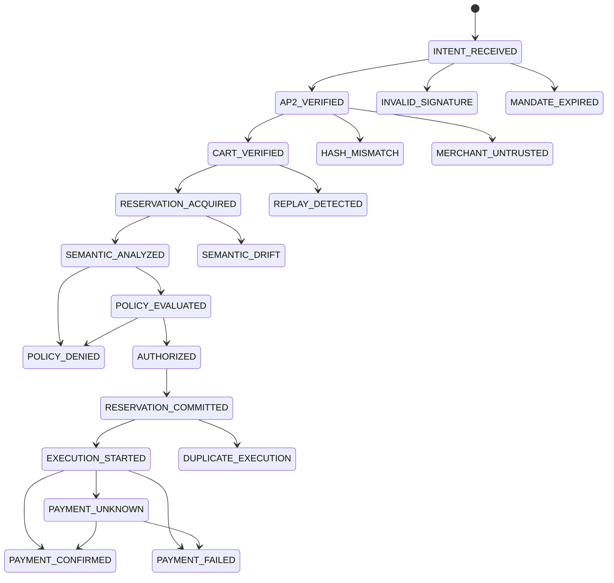

# Part 3 — Redis, Payment Lifecycle, Audit Chain (Chapters 8–10)

← [Main guide](VILR_DEEP_DIVE.md) · ← [02](02_ai_crypto_policy.md) · Next → [04_security_attacks_testing.md](04_security_attacks_testing.md)

---

# Chapter 8 — Redis, atomicity, replay protection, concurrency

## 8.1 Every Redis operation and its exact role (VERIFIED, `app/idempotency/store.py`)

| Operation | Command(s) | Key | Value | TTL | Role | Called from |
|---|---|---|---|---|---|---|
| `try_reserve` | `SET key val NX EX 300` | `"<open_mandate_hash>:<cart_hash>"` (gateway builds it inline; helper `build_idempotency_key()` with prefix `vilr:idempotency:` is **unused**) | JSON `{transaction_id, status:"reserved", created_at}` | 300 s | **Replay / duplicate-authorization detection** | `gateway.authorize` |
| `release` | Lua `LUA_RELEASE` (GET→owner check→`DEL`) | same | – | – | Free the reservation after semantic exception / policy denial / OPA outage; refuses non-owner and refuses `committed` | `gateway.authorize` except-blocks |
| `commit` | Lua `LUA_COMMIT` (status→`committed`, `EX 86400`) | same | – | 24 h | Intended: make the reservation durable | **never called by the gateway** (grep) |
| `create_execution_token` | `SET vilr:exec_token:<tok> val NX EX 3600` | token | JSON `{transaction_id, status:"available", auth_data{amount,currency,merchant_id,mandate_hash}}` | 3600 s | One-time bearer permission to execute | `gateway.authorize` |
| `consume_execution_token` | Lua `LUA_CONSUME_EXEC_TOKEN` | token | flips `available`→`consumed`, `KEEPTTL`; returns `auth_data` | keeps | **At-most-once consumption + parameter binding** | `gateway.execute` |
| `is_reserved_or_committed` | `GET` | – | – | – | introspection | tests only |
| `/health` | `PING` | – | – | – | liveness | `main.health_check` |

Not present: rate limiting, distributed locks (Redlock), nonce sets, counters, pub/sub, streams.

**Roles in plain words:** Redis here is *idempotency / one-time-token* storage — not a lock manager and not transaction-state storage (transaction state is a Python dict, see §15).

## 8.2 Redis fundamentals you need
- **Data types used:** strings holding JSON (no hashes/sets/streams). Fine for a prototype; hashes + `HSETNX` would avoid JSON parse in Lua.
- **Atomicity.** Redis executes commands on one thread. A single command (`SET NX EX`) is atomic; a **Lua script** runs to completion with no interleaving. Multiple *separate* commands are **not** atomic together.
- **TTL.** `EX 300` makes the key vanish after 300 s. TTL is what turns "once ever" into "once per 5 minutes" (see gap).
- **`SET key val NX`** = "set only if not exists" — the primitive behind both reservation and token creation.

## 8.3 The classic bug: read-modify-write (TOCTOU) — worked example
Pseudo-code of a **non-atomic** check:
```python
if not redis.get(key):          # (1) check
    redis.set(key, "reserved")  # (2) act
    call_provider()             # (3) side effect
```
Two simultaneous requests A and B:
1. A: `GET` → nil. 2. B: `GET` → nil (A hasn't written yet). 3. A: `SET`. 4. B: `SET`. 5. Both call the provider → **double payment**.
The window between *check* and *act* is the **time-of-check-to-time-of-use** race.

**How VILR avoids it:** the check and the act are the *same* command. `SET key val NX EX 300`: one of A/B gets `OK`, the other gets `nil` (VERIFIED: `try_reserve`). For tokens, the check-and-flip is one Lua script: read status, compare four parameters, write `consumed`, all atomically (`LUA_CONSUME_EXEC_TOKEN`).

```lua
-- LUA_CONSUME_EXEC_TOKEN (abridged)
local current = redis.call("GET", key)
if not current then return "NOT_FOUND" end
local data = cjson.decode(current)
if data.transaction_id ~= tx_id then return "OWNERSHIP_FAILURE" end
if data.status == "consumed" then return "ALREADY_CONSUMED" end
if tostring(data.auth_data.amount) ~= expected_amount then return "PARAM_MISMATCH" end   -- + currency, merchant, mandate_hash
data.status = "consumed"
redis.call("SET", key, cjson.encode(data), "KEEPTTL")
return cjson.encode(data.auth_data)
```
Key property: a request with *wrong parameters* gets `PARAM_MISMATCH` **without** flipping the status, so an attacker cannot burn a victim's token by guessing. Exactly one concurrent call with correct parameters returns `auth_data`; the rest get `ALREADY_CONSUMED` → `DuplicateExecution` → HTTP 409.

**Evidence it works under concurrency (VERIFIED, my run):** `tests/integration/test_concurrency.py::test_concurrent_execution[10/50/100]` — exactly 1×200, N−1×409, `payment_call_count == 1`, `payment_creation_count == 1`; simulator T-08 PASS (2 concurrent, 1 winner, provider created 1 payment). This is **in-process ASGI concurrency over one event loop against a real Redis** — meaningful for the Lua/`SET NX` atomicity, not a multi-worker or multi-host test.

## 8.4 Idempotency keys, replay, duplicates — terms
- **Idempotency:** performing an operation N times has the same effect as once. Needs a stable key. Here: replay key = `(open_mandate_hash, cart_hash)`; provider key = caller-chosen `provider_idempotency_key`.
- **Replay attack:** resending a previously valid request. **Duplicate request:** an honest retry/double-click. Same mechanism handles both; they differ in intent.
- **At-most-once vs exactly-once.** At-most-once: never twice (maybe zero times). Exactly-once: once, always — impossible in general over unreliable networks without cooperation of the downstream system. VILR's repo itself downgraded the claim to "at-most-once gateway execution-token consumption" (`docs/VILR_FINAL_CLAIM_AND_EVIDENCE_AUDIT.md`, DOCUMENTED) — echo that wording.

## 8.5 What the implementation prevents — and the gaps (my probes)

| Scenario | Outcome | Evidence |
|---|---|---|
| Same signed request twice within 300 s | 2nd → `REPLAY_DETECTED` 409 | T-04, T-22 PASS (my run) |
| Same token used twice / concurrently | 2nd → `DuplicateExecution` 409; provider called once | test_concurrency, T-08 |
| Token + different amount/currency/merchant/mandate_hash | `InvalidRequest` 400, token intact | `test_pa_*`, Lua |
| Token used with other transaction_id | `OWNERSHIP_FAILURE` → 400 | T-24 (the one execution-attack case whose body is well-formed) |
| **Replay after the 300 s reservation expires** | **2nd authorization succeeds; 2nd payment executes** | probe **P4**: forced `EXPIRE key 1` to emulate the TTL; same mandate+cart re-authorized and the mock provider created **2** payments. `RESERVATION_COMMITTED` is only a log label; `commit()` (which would extend to 24 h) is never called. Simulator T-23 *fails* for this reason (and is also malformed: it just authorizes once) |
| Replay key bypass via merchant-chosen `open_mandate_hash` | new key → authorized again | probe **P7c** |
| Authorize replay with the **same `transaction_id`** | 409 as designed, **but** `authorize()` first overwrites `_tx_states[tx_id]` with a fresh `INTENT_RECEIVED` controller; the original's later `/execute` consumes the Redis token then fails `Payment can only be executed after reservation is committed` (409) — **token burned, no payment** | probe **P3**: `payments created: 0` |

Mandate `exp` (JWT) is the outer bound on the replay window in practice: after `exp + 30 s` the verifier rejects the mandate. In the simulator mandates live 3600 s, so the window between 300 s and 3600 s is exploitable in this environment. **Real exposure depends on the issuer's chosen `exp`** (UNKNOWN for production).

**How to explain the gap in an interview (honest and strong):** *"Replay protection is a Redis reservation with a 300-second TTL. The code has a commit script to extend it, but the gateway never calls it, so after the TTL, only mandate expiry protects against replay. I found that by reading the state machine against the Redis calls, and I reproduced a double payment on the mock provider by expiring the key. The fix is to either commit the reservation after AUTHORIZED, or make the key TTL equal the mandate's remaining lifetime, and to consume the mandate_id as a one-time nonce."*

## 8.6 Failure scenarios (distinguish tested vs hypothetical)

| Scenario | What the code does | Tested? |
|---|---|---|
| **Redis unavailable at authorize** | `try_reserve` raises `IdempotencyUnavailable` → denied (HTTP 400 via `VILRError`) | `test_redis_unavailable_fails_closed` (points the store at an unreachable host and only asserts *some* exception — a weak assertion) |
| Redis unavailable at execute | `consume_execution_token` doesn't catch `RedisError` → unhandled → HTTP 500; no payment | by reading; no test |
| **Key expiration** (reservation) | see P4 gap; (token, 3600 s) → `NOT_FOUND` → `ValueError("Invalid or expired execution token")` (`gateway.execute` converts `ValueError` → `InvalidRequest`, HTTP 400) | **Untested.** `test_pa_12` only checks the executor's *state guard* with a `MANDATE_EXPIRED` state; T-40 is a malformed body (422) and proves nothing about expiry |
| **Two concurrent requests** | one winner | tested (above) |
| **Retry after timeout** | If the client times out calling `/execute` but the server consumed the token, a retry gets 409 `DuplicateExecution`. The client can't learn the outcome (no status endpoint for payment; `resolve_unknown` has no route) | hypothetical |
| **Process crash after authorization** | `_tx_states` (a dict) is gone. `/execute` consumes the token then raises "State not found" → token burned, **no payment**; user must re-authorize — but the Redis reservation still blocks re-authorization of the same mandate+cart for up to 300 s | by reading; no test |
| **Provider success, app failure** (crash / exception after provider returned) | money may have moved, token consumed, audit may lack the final record; no reconciliation job | hypothetical (see Ch. 15) |
| **Stale Redis state / Redis restart** | docker-compose runs Redis with `--save "" --appendonly no` → **all reservations and tokens vanish on restart** (outstanding tokens become unusable; replay protection resets) | config reading |
| Duplicate provider callbacks | n/a — no webhooks implemented | – |

> **Do not claim** "a Redis lock guarantees exactly-once payments". The Lua consume makes the *gateway's permission* single-use. The provider call happens *after* it and is not atomic with it: if the process dies between `consume` and the provider response, you have "consumed, outcome unknown".

---

# Chapter 9 — Razorpay integration and payment lifecycle

## 9.1 Which provider actually runs?
- `app/main.py::lifespan` always does `provider = MockRazorpayProvider()` — **the HTTP app never uses real Razorpay**. (VERIFIED.)
- `RazorpayPaymentProvider` (`app/execution/razorpay_provider.py`) is only attached by `scripts/cli.py demo --provider razorpay` (and that same demo swaps Redis and OPA for in-file fakes — `FakeIdempotencyStore`, `FakePolicy`). So the README "safe demo … with real infrastructure" is only partly true: only Gemini/Razorpay/Supabase are optionally real; Redis and OPA are faked in that command. (VERIFIED, `scripts/cli.py:181-260`.)
- The `razorpay` and `supabase` packages are **not listed in `pyproject.toml`**, so `pip install -e .` does not install them (my environment: neither present). The real-provider/Supabase paths cannot run from a clean install — a reproducibility gap. (VERIFIED.)

## 9.2 What the real provider does
```python
# app/execution/razorpay_provider.py (abridged)
amount_in_paise = int(float(request.amount) * 100)
data = {"amount": amount_in_paise, "currency": request.currency,
        "receipt": request.transaction_id[:40],
        "notes": {"merchant_id": ..., "vilr_mandate_hash": ..., "vilr_idempotency_key": ...}}
order = self.client.order.create(data=data)      # run in a thread executor
return ExecutionReceipt(provider_transaction_id=order.get("id"), status="SUCCESS", ...)
```
Facts and implications:
- It **creates a Razorpay Order** (`order_…`), not a captured payment. In Razorpay's model: *Order* (what to pay, amount/currency) → customer pays on Checkout → *Payment* (`pay_…`) is *authorized* → *captured* → later *settled* to the merchant. So `SUCCESS` here means "order created", not "money received". (The audit doc's "real `pay_xxx` response" is DOCUMENTED but the code returns the order id.)
- **Mode:** determined only by the key pair in `RAZORPAY_KEY_ID/SECRET`; the code never asserts a test-mode (`rzp_test_`) prefix. Put live keys in and it creates live orders. "Razorpay in test mode" is therefore a **deployment/config** fact, not a code guarantee. UNKNOWN which keys were used in the author's runs.
- Amount math: `int(float(Decimal) * 100)` — float rounding risk (e.g., 0.29×100 = 28.999…→28). Safer: `int(Decimal(amount)*100)` with quantize.
- **Idempotency at the provider level:** the key is only placed inside `notes`; the code doesn't send an idempotency header. Whether Razorpay dedups on this is **UNKNOWN** (don't assert it). The *mock* implements real idempotency semantics (fingerprint + `asyncio.Lock`), which is why the tests pass.
- Timeout handling: `except httpx.TimeoutException → UNKNOWN`, but the Razorpay Python SDK is built on `requests`, so a real network timeout would raise a `requests` exception and fall into `except Exception → FAILED` (INFERRED — I could not install the SDK to confirm). That would turn an *ambiguous* outcome into a *definite* failure, tempting a retry. The UNKNOWN path is currently exercised only by the **simulated** `injected_timeout_after_acceptance` flag (which raises `httpx.ReadTimeout` itself). Treat this as a likely bug.
- No webhooks, no signature verification (`razorpay.utility.verify_payment_signature`/HMAC) anywhere (grep). Forged-callback attacks are therefore *not applicable*, because no callback exists — and neither is confirmation of later capture.

## 9.3 Payment lifecycle in VILR's state machine

(From `VALID_TRANSITIONS`; failure states and `PAYMENT_CONFIRMED`/`PAYMENT_FAILED` are terminal. `SEMANTIC_DRIFT` and `MERCHANT_UNTRUSTED` are reachable in the table but **never entered by the code** — dead states.) Because `AP2_VERIFIED` has no edge to `INVALID_SIGNATURE`/`MANDATE_EXPIRED`, closed-mandate failures raise `InvalidStateTransition` (Ch. 4.6).

## 9.4 "Should this payment proceed?" — the exact gate
`execute()` proceeds only if (1) the Lua consume returned `auth_data` (token exists, belongs to `transaction_id`, unconsumed, 4 params equal), (2) `_tx_states[tx_id]` exists, and (3) `PaymentExecutor.execute` sees `state == RESERVATION_COMMITTED`. Then `EXECUTION_STARTED` and the provider call. (VERIFIED.)

## 9.5 Ambiguous outcomes and blind retries
**Scenario:** the provider accepted the request, the response was lost (timeout). From the client's view: no answer. If it retries a *new* payment, the customer might be charged twice.
VILR's stance (VERIFIED in code/tests): a provider-reported `UNKNOWN` moves to `PAYMENT_UNKNOWN`; there is **no automatic retry** (`test_unknown_cannot_trigger_automatic_retry`), reconciliation goes through `get_payment_status(idempotency_key)` and `reconcile` (`test_pa_04/05`, `test_reconciliation_cannot_create_second_payment`), and the gateway's receipt states `automatic_retry="NO"`, `reconciliation="REQUIRED"`.
Missing: an HTTP route for reconcile (`resolve_unknown` is only a method), a background reconciler, and `get_payment_status` on the real provider (`reconcile` raises `NotImplementedError` for it).
**Why blind retry is dangerous:** the first call may have succeeded; a retry creates a second charge unless the *provider* deduplicates on a stable idempotency key you reuse. The right order is: query by idempotency key → decide → only then retry with the *same* key.

## 9.6 Local vs provider validation
Local: schema, signatures, hash, policy, token parameters. Provider: card/UPI validity, fraud, balance. They are complementary; local checks cannot guarantee the provider will accept, and a provider success doesn't prove VILR policy was followed (VILR is the only place that enforces the mandate).

## 9.7 Test mode ≠ live readiness
A successful mock or Razorpay-TEST run proves wiring and happy-path/failure-handling logic. It does not prove: real latency, real timeout semantics, webhook handling, refund/chargeback flow, PCI scope, or live-key hygiene. The repo states "hackathon-ready prototype", "Mock Razorpay", "AP2-compatible, not compliant" (DOCUMENTED). Repeat those caveats.

---

# Chapter 10 — Supabase and the tamper-evident audit record

## 10.1 What exists
- **Schema/migrations:** none in the repo (no `.sql`). From code the table is `audit_ledger` with at least `id` (ordering), `transaction_id`, and a JSON column `record`. Types, constraints, indexes, RLS: **UNKNOWN**. `docs` say "Row Level Security is disabled for this hackathon prototype" (DOCUMENTED).
- **Default ledger is in memory.** `main.py` uses Supabase only if both `SUPABASE_URL` and `SUPABASE_KEY` are set; else `MemoryAuditLedger` (lost on restart). My runs used memory. Supabase behavior was **not** run by me (no credentials) → everything below about Supabase is VERIFIED *by reading* only.

## 10.2 Record contents (`AuditRecord`)
`transaction_id, user_id, agent_id, merchant_id, intent_hash, open_mandate_hash, cart_hash, policy_decision, semantic_decision, semantic_confidence, authorization_status, timestamp, nonce, payment_attempt_id, execution_status, failure_reason, state, prev_record_hash, record_hash, investigation, evidence, explanation, risk, policy_metadata`.
Note: `agent_id` is never populated (always `"unknown"`); `intent_hash` is never passed in by `authorize()` so it stays `"unknown"`, which makes `SecurityReceipt.intent_verified` evaluate false for every transaction (VERIFIED by reading `context`); the final `evidence` mixes in `DecisionEvidence` with `evidence_hash`.

## 10.3 Construction, linking, verification
```python
# gateway._log (abridged)
last = await self.audit.get(tx_id)
prev_hash = last.record_hash if last else GENESIS_HASH
data = {... "timestamp": datetime.now(), "nonce": uuid.uuid4().hex, "state": state.value, "prev_record_hash": prev_hash, ...}
rec = self.audit.build_record(data)   # record_hash = SHA256(json.dumps(model_dump(json) minus record_hash, sort_keys, compact))
await self.audit.record(rec)
```
`verify_chain(tx)` (both ledgers): start at `GENESIS_HASH`; for each record in order: check `prev_record_hash == expected_prev`, recompute the hash, compare with `record_hash`, set `expected_prev`. Exposed at `GET /v1/audit/{tx}/verify`. Tests: `test_a_01…a_08` (genesis, chain, modified, deleted, reordered, broken prev-hash, independent chains, ordering), simulator T-13, T-36–T-39 (memory ledger).

## 10.4 What the guarantees actually are
| Property | Holds? | Why / evidence |
|---|---|---|
| Edit of any field in a stored record is detected | **Yes** (if the verifier is run on the stored data) | hash covers all fields; T-36/`test_a_03` |
| Deleting/reordering a record **in the middle or the front** is detected | Yes | prev-hash link; T-37, T-38, `test_a_04/05` |
| **Truncating the tail** (removing the newest records) | **No — still `valid: True`** | my probe P8: 4-record chain, pop last → `valid: True, records_checked: 3` |
| A **dropped write** (Supabase insert error swallowed) | **Undetectable** — next record links to the last stored one | probe P8; `SupabaseAuditLedger.record` catches all exceptions, logs, returns normally |
| Ordering of concurrent writers | **Not guaranteed**: `_log` does "read latest → write next" with no lock/transaction; two concurrent `_log` calls for the same `transaction_id` can both link to the same parent (fork) — then `verify_chain` flags `PREV_HASH_MISMATCH` and a legitimate chain looks tampered | by reading; concurrency arises e.g. on parallel `/execute` for one tx |
| Resistance to someone who can rewrite *all* rows of a transaction (DB admin, leaked service key) | **No** | no secret in the hash (plain SHA-256), no signature, no external anchor; the attacker recomputes every hash |
| Whole-ledger consistency across transactions | Not provided | chains are per `transaction_id`; no global sequence or Merkle root |
| Failure of audit blocks payment | **No — fail-open for audit** | swallowed exceptions; payment continues |

**Tamper-evident vs tamper-proof.** *Evident*: modifications are detectable by someone who holds a trustworthy reference. *Proof/prevention*: modifications can't happen. A hash chain gives the former only, and only against an attacker who cannot also recompute the chain **and** whose latest hash you recorded elsewhere. The repo's own language is "tamper-evident", never "immutable" (DOCUMENTED; claims audit replaced "immutable"/"WORM"), which is correct — keep to it.

**To resist a DB administrator you would add (proposed, none implemented):**
1. Sign each record (or each head hash) with a key the DB admin does not hold (KMS/HSM, ES256).
2. Periodically **anchor** the head hash externally (transparency log, immutable object store with object-lock/WORM, a second cloud account, or a public timestamp).
3. Per-chain **sequence numbers** + a uniqueness constraint `(transaction_id, seq)` and `INSERT`-only DB role; revoke `UPDATE/DELETE`; enable RLS; separate writer and reader credentials.
4. Write inside a DB transaction (or use `SELECT … FOR UPDATE`/advisory lock) so concurrent writers serialize.
5. Make audit write failure **block** (or queue via an outbox) rather than swallow.
6. Retention policy, PII minimization (the record includes `user_id`; `GET /v1/audit/{tx}` is unauthenticated).

## 10.5 Concepts
- **Append-only log:** only inserts. Enforced by DB permissions, not by hashing.
- **Hash chain:** `h_i = H(record_i ‖ h_{i−1})`; changing record *k* changes all later hashes, so a verifier holding the *latest* trusted hash can detect it. Here the latest hash is **not stored separately**, which is why tail truncation passes.
- **Digital signature vs hash chain:** signatures bind to a key; hash chains bind to order/history. You usually want both.
- **Canonical serialization:** hashing JSON requires deterministic bytes; here `json.dumps(sort_keys, separators)` over `model_dump(mode='json')`. Timestamps are naive local `datetime.now()` (no timezone) — fine for hashing, poor for forensic correlation.
- **Concurrency in audit writers:** need either per-chain serialization or a DB-assigned sequence; absent here.
- **Transactions/consistency:** a DB transaction can't span Redis + provider + Supabase; hence outbox/saga ideas (Ch. 15).

---

*Continue with [04_security_attacks_testing.md](04_security_attacks_testing.md).*
