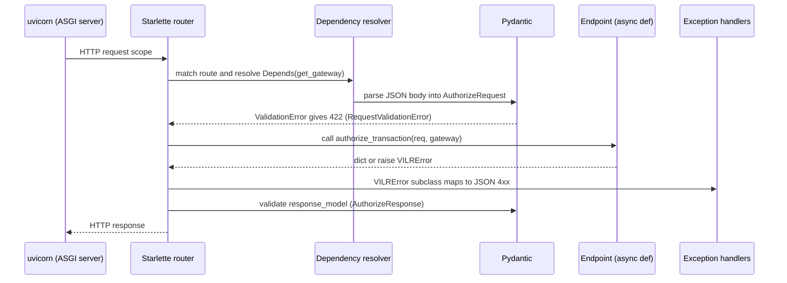

# Part 5 — Backend, Distributed Systems, Algorithms, Stack (Chapters 14–17)

← [Main guide](VILR_DEEP_DIVE.md) · ← [04](04_security_attacks_testing.md) · Next → [06_design_and_interview_defense.md](06_design_and_interview_defense.md)

---

# Chapter 14 — Backend engineering fundamentals (FastAPI)

The backend is **FastAPI (Starlette + Pydantic v2) on uvicorn**, fully `async`. Below, every concept is given as: **Simple → Internals → In VILR → Failure modes → Likely question.**

## 14.1 Request lifecycle (the one diagram to memorize)


## 14.2 Concept table

| Concept | Simple | Internals | In VILR | Failure modes | Likely question |
|---|---|---|---|---|---|
| **Request–response** | client sends, server answers | ASGI scope→receive/send callables | `POST /v1/authorize`, `/v1/execute` | slow dependency blocks response (Gemini up to 30 s) | "Walk me through what happens on POST /authorize." |
| **Schemas & validation** | declare shapes; framework enforces | Pydantic v2 compiles validators; types coerced (`"45000.00"`→`Decimal`) | `AuthorizeRequest`, `Cart`, `CurrencyCode` regex, `Money ≥ 0`, `quantity ≥ 1`, `Identifier min_length=1` | **unknown fields are silently ignored** (dropped `description`), no `extra="forbid"`; no max lengths on `merchant_id` etc.; `raw_prompt` unbounded at API | "What does Pydantic not protect you from?" |
| **HTTP status codes** | numeric outcome class | handlers in `main.py` | 401 sig, 400 hash/expiry/semantic, 403 policy/merchant, 409 replay/duplicate/state, 422 schema, 502 `PaymentUnknown` (never raised), 400 generic `VILRError` (includes policy/Redis outage, payment failure), 500 unhandled | wrong semantics: OPA outage = 400 (should be 503); `UNKNOWN` payment returns **200** with `status:"UNKNOWN"` | "Which status for a policy outage and why?" |
| **Dependency injection** | framework hands collaborators to handlers | `Depends(get_gateway)` reads `request.app.state.gateway`; the gateway receives **Protocol-typed** collaborators in its constructor | tests replace `gateway.policy = MockOPADeny()` etc. | `app.state` is a global singleton; the CLI also monkey-patches attributes | "How did you make this testable?" |
| **Sync vs async** | async lets one thread serve many waiting requests | event loop; `await` yields at I/O | httpx/redis-py/genai async; Supabase client is sync → `asyncio.to_thread`; Razorpay SDK sync → `run_in_executor` | **CPU/sync work inside coroutines blocks the loop**: JWT verification, file read + SHA-256 in `get_policy_metadata()` on every OPA call, `float()` math | "Why `to_thread`?" |
| **Concurrency & shared state** | many requests interleave | single-thread cooperative scheduling: no preemption between `await`s | `_tx_states` dict mutated across awaits; Redis for cross-request exclusion | per-process dict ⇒ fails with >1 worker/instance or restart; `authorize` overwrites state for same tx_id (P3) | "What breaks if you run 4 workers?" |
| **Error handling** | convert failures to meaningful outcomes | custom `VILRError` hierarchy + handlers; try/except in gateway adds failure state + audit then re-raises | state transition + risk + audit on each domain failure | broad `except Exception` in verifier & provider; swallowed Supabase errors; closed-mandate failure bug | "Where do you fail closed vs open?" |
| **Timeouts** | bound waiting | httpx `timeout=`; `asyncio.wait_for` | OPA 2 s; Gemini 30 s; Anthropic 30 s; **Redis: none configured**; Supabase: none | hung Redis = hung request | "What timeouts did you set and why?" |
| **Retries** | try again after transient failure | – | **none anywhere** (grep) — deliberate for payments; for LLM/OPA it fails closed instead | no automatic recovery for transient OPA blips | "Why no retry?" (payments: unsafe; idempotent reads could) |
| **Environment config** | settings from env | `pydantic-settings` `BaseSettings(env_file=".env")` | `Settings` in `config/settings.py` (module-level singleton) | defaults like `redis://redis:6379` assume Docker; empty-string secrets allowed (no startup validation that required keys exist) | "How do you manage config per environment?" |
| **Secrets** | keep keys out of code | env vars; `.env` gitignored | API keys read from settings; evidence excludes secrets (test) | `structlog` logs ids/hashes; `RazorpayPaymentProvider` logs errors with `str(e)`; no secret scanner/CI | "How would you rotate the Razorpay key?" (UNKNOWN: no procedure) |
| **Logging/observability** | emit events to understand behavior | `structlog.get_logger()` default config; stdlib `logging` in providers; `PerformanceTracker` timings | state names as log events; `_last_perf` | `/v1/metrics` is a stub returning `{"status":"ok"}`; `run_metrics.py` prints **hard-coded** figures; `_last_perf` is shared mutable state | "How would you know the gateway is unhealthy?" |
| **DB interactions** | persist data | supabase-py (PostgREST) | insert/select by `transaction_id` ordered by `id` | no transactions/locks/constraints in code; swallowed errors | "How do you guarantee audit order?" |
| **External-service clients** | wrap 3rd-party APIs | provider classes behind Protocols (`LLMProvider`, `PaymentProvider`) | Gemini, OPA, Redis, Razorpay, Supabase | new `httpx.AsyncClient` per OPA call (no pooling); new Redis connection in `/health` | "Why a Protocol per dependency?" |
| **Testing & mocks** | replace slow/unsafe parts | `unittest.mock`, fake classes with injection points | `MockLLMProvider`, `MockRazorpayProvider` (`injected_*`) | mock/real divergence | see Ch. 13 |
| **Resource cleanup** | free connections | `lifespan` context manager | `await redis_client.close()` (deprecated; `aclose()`) | httpx/Supabase clients never closed | "What happens on shutdown?" |
| **Idempotency** | repeated call = same effect | keys + atomic ops | Ch. 8 | TTL gaps | Ch. 8 |
| **Serialization** | objects ⇄ bytes | `model_dump(mode='json')`: Decimal→str, datetime→ISO; JCS for hashing | cart/audit/evidence | numeric string forms; naive timestamps | Ch. 6 |
| **Transaction boundaries** | what commits together | none across Redis/provider/Supabase | – | partial failure (Ch. 15) | "Where's your transaction boundary?" |

## 14.3 Mini-lab: what is `Depends` doing here?
```python
async def get_gateway(request: Request):          # app/api/deps.py
    return request.app.state.gateway
@router.post("/authorize", response_model=AuthorizeResponse)
async def authorize_transaction(req: AuthorizeRequest, gateway = Depends(get_gateway)):
```
FastAPI inspects the signature: `req` is a Pydantic model ⇒ parse body; `gateway` is a `Depends` ⇒ call `get_gateway` per request. It doesn't build the gateway; `lifespan` in `main.py` does, once. This is "DI by service locator on `app.state`", simple and sufficient here.

## 14.4 A subtle thing about `response_model` and routes
`/v1/authorize` always returns `message="Authorization successful"`, `reservation_status="COMMITTED"` literals even though the Redis reservation is not committed (Ch. 8). A reader-level detail that is easy to trip over in an interview: **a response field says COMMITTED while the store says `reserved`.**

---

# Chapter 15 — Reliability and distributed-systems design

## 15.1 Where does state live?

| State | Location | Durability | Authority for |
|---|---|---|---|
| Transaction state machine position | Python dict `GatewayOrchestrator._tx_states` | none (process memory) | whether `/execute` may call the provider |
| Replay reservation | Redis key `"<open_hash>:<cart_hash>"` | none in compose (`--save "" --appendonly no`), TTL 300 s | duplicate authorization |
| Execution token | Redis `vilr:exec_token:*`, TTL 3600 s | same | one-time execution permission |
| Payment fact | provider (mock: process dict; Razorpay: provider) | provider-durable (real) | whether money/order exists |
| Audit trail | Memory list **or** Supabase Postgres | memory: none; Supabase: durable | history/forensics (not authority) |
| Idempotency at provider | provider's own store keyed by `idempotency_key` (mock implements it) | provider | provider-level dedup |

**When they disagree:** there is *no reconciler*. Examples: token consumed but provider never called (restart) → user must re-authorize, replay key may still block; provider has the payment but local state/audit missing → nothing detects it.

## 15.2 Concepts, tied to the system
- **Consistency / atomicity / durability (ACID's C, A, D):** each store gives these *individually* (Redis Lua = atomic; Postgres = durable) but nothing spans them.
- **Partial failure:** a distributed operation where some steps happened. The defining problem here: *consume token → call provider → write audit* are three separate side effects.
- **Why a local DB transaction doesn't help:** it can only cover one database. Redis, provider and Postgres can't join one 2PC without cooperation.
- **Idempotent request processing:** same request twice, same outcome. VILR: reservation + token + provider key.
- **Retries/timeouts:** safe only with idempotency keys end-to-end.
- **Compensation / reconciliation:** after the fact, query the provider by idempotency key and fix local state; or refund/void.
- **Outbox pattern *(proposed)*:** write "intent to call provider" and the state change in **one local DB transaction**, and have a worker perform the call and mark completion, retrying with the same idempotency key. Gives at-least-once call + provider dedup ⇒ effectively-once.
- **Saga *(proposed)*:** a sequence of local steps with compensating actions (authorize → reserve → execute → confirm; if later steps fail, undo). Appropriate for the multi-system flow.
- **Eventual consistency:** accept temporary disagreement and converge via reconciliation.
- **Observability:** correlation by `transaction_id` exists in logs and audit; no metrics endpoint, no tracing.

## 15.3 State-transition model (the actual one)
The graph is in [Ch. 9.3](03_state_payment_audit.md). Key points: terminal failure states cannot proceed; only `PAYMENT_UNKNOWN` leaves a non-final state besides success path; `RESERVATION_COMMITTED → DUPLICATE_EXECUTION` exists but the duplicate path **does not** use the transition for the original tx's controller beyond logging (and it requires the controller to still exist).

**A shared-mutable-state hazard (plausible, tier B — not reproduced).** The duplicate-token branch of `execute()` calls `state.transition_to(DUPLICATE_EXECUTION)` on the *same* `StateController` the winning request uses. `DUPLICATE_EXECUTION` is only reachable from `RESERVATION_COMMITTED`. If a losing request's coroutine resumes after Redis answers `ALREADY_CONSUMED` but *before* the winner's coroutine reaches `PaymentExecutor.execute`'s state guard (ordering of two awaited Redis replies is not guaranteed across pooled connections), the loser flips the shared state and the winner's guard then fails with `InvalidStateTransition` — token consumed, **no payment**. The failure is safe (no double spend) but it is a lost-payment liveness bug. The 10/50/100-way concurrency tests passed in my run, so it is at least rare in-process. A per-request state copy, or deciding the duplicate path without mutating shared state, avoids it.

## 15.4 The six required scenarios

| # | Scenario | What happens today | Implemented recovery? | Proposed |
|---|---|---|---|---|
| 1 | **Authorization succeeds, payment execution fails** | `PaymentExecutor` sets `PAYMENT_FAILED` (provider `FAILED` or raised error); token is **already consumed**; audit records `execution_status=FAILED`; HTTP 400/200-with-FAILED depending on path | Partial: failure is recorded; no re-authorization shortcut (the user must start over; replay key blocks re-use for ≤300 s) | allow a *new* token for the same authorization when the provider confirms FAILED (state machine edge `PAYMENT_FAILED → AUTHORIZED`), with fresh provider idempotency key |
| 2 | **Provider accepts but the process crashes** | token consumed, no audit of outcome, `_tx_states` lost; provider holds a payment | **None** | outbox row written *before* the provider call; startup reconciler queries provider by idempotency key; persistent state in Postgres |
| 3 | **Payment succeeds but audit persistence fails** | `SupabaseAuditLedger.record` swallows the exception; user sees success; chain remains "valid" with a gap | **None** (fail-open) | write audit *first* (intent) and *then* outcome, block on failure or enqueue to outbox; gap-detecting sequence numbers |
| 4 | **Redis holds stale state** (TTL elapsed / restart) | replay allowed again (P4); outstanding tokens invalid | **None** | persistent Redis (AOF) **plus** durable record of consumed mandate ids in Postgres; TTL ≥ mandate lifetime |
| 5 | **Two requests race** | one wins at `SET NX` / Lua; loser gets 409 | **Yes** (tested) | – |
| 6 | **Caller retries after an ambiguous timeout** | `/authorize` retry → 409 replay (token inaccessible); `/execute` retry → 409 duplicate; no status endpoint returns the original outcome; `resolve_unknown` has no HTTP route | **Partial** (no double charge; but client can't recover the result) | idempotent "get result by transaction_id"/provider key endpoint; return the *original* receipt for duplicate requests (standard idempotency-key semantics) instead of 409 |

**Implemented vs proposed (be explicit):** implemented = fail-closed authorization, atomic single-use token, provider idempotency (mock), no auto-retry on UNKNOWN, reconcile method, hash-chained audit. Proposed = everything in the right-hand column.

## 15.5 At-most-once vs exactly-once, applied
Gateway-level consumption is **at-most-once**. Whether the *payment* happens at-most-once depends on the provider honoring the idempotency key; whether it happens *at least once* after authorization is **not** guaranteed (crash window). Exactly-once = at-most-once call permission + at-least-once retry + idempotent receiver (provider). VILR has the first and (in the mock) third, not the second.

---

# Chapter 16 — Algorithms, complexity, and alternatives

> Cryptographic *security* is not computational *complexity*. "O(1)" or "O(n)" tells you cost, not strength.

### A1. JSON canonicalization + cart hash (`compute_jcs_hash`, `compute_checkout_hash`)
- **Problem:** make two parties compute the same digest for the same logical cart.
- **In/out:** `Cart` → `base64url(SHA-256(JCS(payload)))`.
- **Steps:** project cart to {merchant_id, currency, total_amount(str), items[{item_id, quantity, unit_price(str), currency}]} → `rfc8785.dumps` (sort keys, ES6 numbers, UTF-8) → SHA-256 → base64url (no padding).
- **Complexity:** time/space O(n) in cart size (sorting object keys O(k log k) per object; item order preserved).
- **Assumptions:** both sides project the *same fields* and format numbers/decimals identically.
- **Security properties:** second-preimage resistance of SHA-256 ⇒ can't craft another cart with the same digest.
- **Edge cases:** `Decimal` string forms (`45000` vs `45000.00`); excluded fields (name/category/brand); unit_price×qty ≠ total allowed.
- **Alternatives:** sign the JCS bytes directly (JWS over the cart); Merkle tree over items; protobuf deterministic encoding.
- **Source:** `app/security/crypto.py`.

### A2. JWT/ES256 verification (`_verify_jwt`)
- **Steps (conceptual):** split token → base64url-decode → check `alg == ES256` (from allow-list) → recompute SHA-256 of `header.payload` → ECDSA verify with the P-256 public key → validate `exp`/`iat` with leeway.
- **Complexity:** one ECDSA verify (constant cost, ≈ tens of µs–ms) + O(token length).
- **Assumption:** the public key belongs to the claimed party — **not established** here.
- **Alternatives:** Ed25519 (EdDSA), JWS detached payloads, SD-JWT/VC (the "AP2-compatible" docs note this is simplified).
- **Library vs implementation:** you *use* `PyJWT`+`cryptography`; you didn't implement ECDSA. Know the concept, not curve arithmetic.

### A3. Replay reservation (`try_reserve`)
- **Problem:** at most one in-flight/accepted authorization per `(open_mandate_hash, cart_hash)` within TTL.
- **Algorithm:** `SET key val NX EX ttl` → `OK` (won) or `nil` (lost).
- **Complexity:** O(1) time, O(1) space per key (until TTL).
- **Security property:** atomic check-and-set ⇒ no TOCTOU. **Weakness:** key components are partly attacker-influenced (`open_mandate_hash` from the closed mandate); TTL 300 s.
- **Alternatives:** `mandate_id` nonce set (`SADD`) with TTL = mandate lifetime; DB unique constraint; consensus-backed lock (not needed).

### A4. Single-use token consumption (Lua)
- **Algorithm:** `GET` → decode → ownership → status → four string equalities → status=`consumed` → `SET … KEEPTTL` → return auth_data. All atomic.
- **Complexity:** O(1) with small constant (cjson encode/decode of a ~200-byte doc).
- **Edge cases:** `tostring(data.auth_data.amount)` vs request `str(Decimal)` — `"45000.00"` ≠ `"45000"` (caller must send the exact string the gateway stored; the simulator copies it); `KEEPTTL` retains the original expiry.
- **Alternatives:** `GETDEL` for pure single-use (loses parameter binding and "mismatch doesn't burn"); Redis `WATCH/MULTI` (optimistic); Postgres `UPDATE … WHERE status='available' RETURNING`.

### A5. Policy evaluation (Rego)
- **Problem:** decide allow/deny and explain.
- **Algorithm:** OPA evaluates every rule body; partial-set `violations` is the union of all firing rule instances; `allow` ⇔ `count(violations)==0`.
- **Complexity:** each rule O(1) except membership `lst[_] == m` O(|lst|); overall O(rules + Σ|lists|) per request. Network round trip dominates (≈10–25 ms documented).
- **Assumptions/edge cases:** undefined (missing field) ⇒ rule silently doesn't fire (fail-open per rule) — §7.4.
- **Alternatives:** hard-coded Python predicates (faster, less auditable); Cedar; OpenFGA; CEL.

### A6. State-transition validation
- **Algorithm:** dict lookup `VALID_TRANSITIONS[current]`; `new in list` → O(k) with k ≤ 3. Raises `InvalidStateTransition`.
- **Property:** prevents out-of-order progress (e.g., can't execute before `RESERVATION_COMMITTED`). **Caveat:** state lives in memory; a missing edge turns a legit failure into a 409 (Ch. 4.6).

### A7. Audit hash chain
- **Append:** read latest record → `prev = latest.record_hash` (or GENESIS) → build record → `record_hash = SHA-256(canonical JSON without record_hash)` → insert. O(1) DB ops + O(size) hash.
- **Verify:** O(n) records, each O(size): link check + recompute.
- **Security properties:** detects in-place edit, middle/front deletion, reorder. **Not:** tail truncation, dropped writes, whole-chain rewrite, concurrent-fork ambiguity.
- **Alternatives:** Merkle tree with signed roots (O(log n) inclusion proofs), signed append-only log (transparency log), Postgres with `INSERT`-only + sequence + external anchoring.

### A8. Deterministic risk score
- Sum of fixed weights over **deduplicated** signals, clamped to 200; thresholds ≥100 CRITICAL, ≥70 HIGH, ≥40 MEDIUM else LOW. O(s²) dedupe over a tiny list. Not used for any decision (`test_risk_score_is_context_only`).

### A9. Attack-suite scheduling
- Sequential loop over `ATTACKS` with a fresh lifespan and `sleep(4)` per case → ≈ 3 min for 42 cases (my run). Result classification in `extract_outcome` is status-code driven, which is why wrong-reason denials (422) count as blocks.

---

# Chapter 17 — Dependency and technology-stack guide

| Technology | Actual use | File | Why used | Alternatives | Trade-offs |
|---|---|---|---|---|---|
| **FastAPI** + **uvicorn** | HTTP API, DI, exception mapping, lifespan | `app/main.py`, `app/api/*` | async I/O, built-in validation/OpenAPI | Flask, Django REST, Go/Gin | easy; async pitfalls with sync code |
| **Pydantic v2** | all models + settings | `app/domain/models.py`, `api/schemas.py` | declarative validation, `Decimal` money | dataclasses+manual, msgspec, attrs | silently ignores extras by default |
| **pydantic-settings** | env config | `app/config/settings.py` | typed config from env/.env | dynaconf, plain `os.environ` | no secret-required validation |
| **httpx** | OPA calls; Anthropic call; ASGI test transport | `policy/engine.py`, `semantic/provider.py`, `simulator/runner.py` | async client, `ASGITransport` for in-process tests | aiohttp, requests | no connection pooling as used (new client each call) |
| **redis-py (asyncio) + hiredis** | idempotency store | `idempotency/store.py` | atomic `SET NX`, Lua | Postgres advisory locks / unique constraints; Memcached (no Lua) | volatile unless AOF; scripts must be tested |
| **Redis server** (compose `redis:7-alpine`) | state store | `docker-compose.yml` | fast atomic ops | DynamoDB conditional writes | persistence disabled in compose |
| **OPA / Rego** (compose `opa:latest`) | policy decisions via HTTP | `policies/*.rego`, `policy/engine.py` | externalized, testable policy, explainable | embedded Python rules; Cedar; OpenFGA | extra network hop & failure mode; floating image tag |
| **PyJWT[crypto] + cryptography** | ES256 sign/verify, P-256 keys | `security/signer.py`, `mandates/verifier.py`, `security/crypto.py` | standard JWT/JWS, audited primitives | `authlib`, `jwcrypto`, PASETO | JWT footguns (alg, claims) must be configured |
| **rfc8785** | JSON canonicalization | `security/crypto.py` | deterministic bytes for hashing | custom `sort_keys` dumps | does not normalize Unicode |
| **hashlib (SHA-256)** | audit/evidence hashes | `audit/*`, `gateway.py` | stdlib | BLAKE2/3, SHA-3 | none significant |
| **structlog** | structured logs | most modules | key-value events | stdlib logging, loguru | not configured (default renderer) |
| **google-genai** | Gemini calls with JSON schema | `semantic/provider.py` | structured output, async client | OpenAI/Anthropic SDKs, Vertex AI SDK | model drift, cost, latency; model name unverified |
| **anthropic** (declared) | **not imported** — `AnthropicLLMProvider` uses raw httpx | `pyproject.toml`; `semantic/provider.py` | – | – | dead dependency |
| **fakeredis, aiosqlite** (declared) | **no imports found** | `pyproject.toml` | – | – | dead dependencies (docs mention SQLite audit; not in code) |
| **razorpay SDK** | real provider (CLI only) | `execution/razorpay_provider.py` | official client | direct REST via httpx | **not in `pyproject.toml`**; sync SDK |
| **supabase-py** | audit persistence | `audit/supabase_ledger.py` | managed Postgres + REST | psycopg/asyncpg direct, SQLAlchemy | **not in `pyproject.toml`**; sync client |
| **pytest, pytest-asyncio, pytest-cov** | tests | `tests/` | async tests | unittest, hypothesis (absent) | no CI |
| **Docker / docker-compose** | local stack | `docker/Dockerfile`, `docker-compose.yml` | reproducible services | podman, k8s | Dockerfile copies only `app/` and `adapters/`, but `routes.py` imports `simulator.scenarios` and `main.py` mounts `static/` ⇒ the image very likely fails at import (INFERRED; I saw the same `ModuleNotFoundError` when `simulator` wasn't on the path; I did not build the image) |

### Library vs algorithm
Using `PyJWT` means *calling* ECDSA verification someone else implemented and audited; implementing ECDSA yourself would be an anti-pattern. In interviews: know **what the library guarantees** (signature validity under a key and algorithm), **what it doesn't** (key authenticity; business meaning), and **which options you set** (`algorithms`, `require`, `leeway`).

### Interview questions per key dependency
- **FastAPI:** how does `Depends` get its value? what turns a `ValidationError` into 422? why is a sync call inside `async def` a problem?
- **Redis:** why Lua? what does `NX` do? what happens at TTL? is `SET NX` a lock? (No — it's a single-use claim; it doesn't give fencing.)
- **OPA:** push vs pull data, `default allow`, what is `rego.v1`, how to unit-test, how to ship policy changes safely.
- **PyJWT:** why `algorithms=[...]`; what are `require`/`leeway`.
- **Gemini:** structured output vs prompt-only JSON; temperature; failure handling.
- **Razorpay:** order vs payment vs capture; why `UNKNOWN` exists.
- **Supabase:** why a hash chain on top of Postgres; what RLS/roles would add.

---

*Continue with [06_design_and_interview_defense.md](06_design_and_interview_defense.md).*
