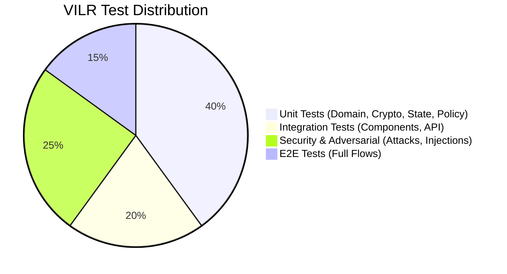

# VILR 2.0 Test Strategy

VILR acts as a zero-trust runtime gateway between AI shopping agents and payment providers. This document outlines the comprehensive testing strategy for VILR 2.0, ensuring that every transaction path and failure mode is rigorously validated before deployment.

## 1. Test Philosophy

Our testing philosophy is fundamentally **Security-First**. As VILR acts as a security enforcement layer for automated financial transactions, the following tenets apply:

- **Default-Deny Validation**: Every component must be proven to fail securely (fail-closed) when encountering invalid, unexpected, or missing data. Default-deny paths are always tested before allow paths.
- **Test-Driven Security**: Every feature, policy, or cryptographic function must have associated unit, integration, and security tests before it is considered functionally complete.
- **Adversarial Mindset**: We assume the AI agent, the merchant, and the network may be compromised or acting maliciously. Testing must simulate these hostile environments continuously.

## 2. Test Pyramid

The VILR test suite is structured as an inverted pyramid, heavily weighting lower-level deterministic tests (Unit/Integration) while utilizing higher-level tests (Adversarial/E2E) for complex systemic vulnerabilities.



1. **Unit Tests**: Fast, deterministic tests verifying domain models, cryptographic operations, state machine transitions, and local policy evaluations.
2. **Integration Tests**: Tests validating interactions between internal components (e.g., Policy Engine calling Semantic Verifier) and API boundaries.
3. **Security Tests**: Automated tests probing for classical vulnerabilities (tampering, replay, denial of service).
4. **Adversarial Tests**: specialized tests focusing on AI-specific vulnerabilities, such as prompt injection and semantic substitution in product metadata.
5. **E2E Tests**: Comprehensive end-to-end transaction flows, from intent creation to payment adapter execution.

## 3. Test Categories and Cases

The following test cases (totaling 65) form the core validation suite. 

### A. Domain Model Tests (8 cases)
Validates the structural integrity and constraints of core entities.

| ID | Test Case | Expected Result |
|---|---|---|
| DM-01 | Valid `UserIntent` creation with all required fields | Success |
| DM-02 | `UserIntent` creation with missing required fields | Validation Error |
| DM-03 | Budget constraint validation (`max_budget` > 0) | Validation Error if <= 0 |
| DM-04 | Currency validation (must be valid ISO 4217 code) | Validation Error if invalid |
| DM-05 | Mandate expiration validation | Validation Error if `expires_at` is in the past |
| DM-06 | Cart total computation | Computed total exactly matches sum of line items |
| DM-07 | State machine valid transitions (e.g., `INTENT_RECEIVED` -> `AP2_VERIFIED`) | Success |
| DM-08 | State machine invalid transitions (e.g., `POLICY_DENIED` -> `AUTHORIZED`) | InvalidStateTransition Error |

### B. Cryptographic Tests (10 cases)
Validates the AP2 (Agentic Payment Protocol) cryptographic guarantees.

| ID | Test Case | Expected Result |
|---|---|---|
| CR-01 | JCS (JSON Canonicalization Scheme) determinism | Identical output for functionally equivalent JSONs |
| CR-02 | `checkout_hash` computation correctness | Hash matches known standard output for given input |
| CR-03 | Signature verification with valid ES256 (ECDSA P-256) signature | Success (True) |
| CR-04 | Signature verification with tampered payload | Failure (False) |
| CR-05 | Price change in cart breaks hash | Verification Failure |
| CR-06 | Quantity change in cart breaks hash | Verification Failure |
| CR-07 | SKU change in cart breaks hash | Verification Failure |
| CR-08 | Merchant ID change breaks hash | Verification Failure |
| CR-09 | Currency change breaks hash | Verification Failure |
| CR-10 | Key pair generation and verification roundtrip | Success |

### C. Idempotency Tests (6 cases)
Validates protection against duplicate and concurrent transaction executions.

| ID | Test Case | Expected Result |
|---|---|---|
| ID-01 | First request with unique idempotency key | Success (200 OK) |
| ID-02 | Duplicate request with identical key (already completed) | Success (Returns cached response) |
| ID-03 | Concurrent requests with identical key | One succeeds, others return 409 Conflict |
| ID-04 | Different composite idempotency keys (distinct open_mandate_hash:checkout_hash) | Success for both |
| ID-05 | Expired idempotency key allows retry | Success (Processes as new) |
| ID-06 | Redis unavailable | Fail-closed (503 Service Unavailable, DENY) |
| ID-07 | Reserve then release on semantic failure | Success (second attempt processes) |
| ID-08 | Reserve then release on policy denial | Success (second attempt processes) |
| ID-09 | Reserve then commit | DENY (subsequent attempts rejected) |

### D. Semantic Verification Tests (8 cases)
Validates the LLM-based semantic matching between User Intent and Merchant Cart.

| ID | Test Case | Expected Result |
|---|---|---|
| SV-01 | Valid intent-cart match (e.g., Intent: "Red shoes", Cart: "Crimson sneakers") | PASS |
| SV-02 | Product substitution (Intent: "MacBook", Cart: "Dell XPS") | FAIL |
| SV-03 | Category mismatch (Intent: "Laptop", Cart: "Phone") | FAIL |
| SV-04 | Brand preference satisfied (Intent: "Nike shoes", Cart: "Nike Air Max") | PASS |
| SV-05 | Over-budget detected semantically | FAIL |
| SV-06 | LLM returns malformed JSON | Graceful failure (DENY) |
| SV-07 | LLM timeout (> configured ms) | Fail-closed (DENY) |
| SV-08 | LLM API unavailable | Fail-closed (DENY) |

### E. Policy Engine Tests (10 cases)
Validates deterministic policy evaluation using OPA (Open Policy Agent).

| ID | Test Case | Expected Result |
|---|---|---|
| PE-01 | Valid transaction under all policies | ALLOW |
| PE-02 | Over-budget transaction | DENY (Reason: BudgetExceeded) |
| PE-03 | Untrusted/blocklisted merchant | DENY (Reason: UntrustedMerchant) |
| PE-04 | Prohibited product category | DENY (Reason: ProhibitedCategory) |
| PE-05 | Expired user mandate | DENY (Reason: MandateExpired) |
| PE-06 | Semantic risk evaluated as HIGH | DENY (Reason: SemanticRisk) |
| PE-07 | Missing required policy inputs | DENY (Reason: MissingData) |
| PE-08 | Default deny (empty or malformed input to OPA) | DENY (Reason: DefaultDeny) |
| PE-09 | Currency mismatch between mandate and cart | DENY (Reason: CurrencyMismatch) |
| PE-10 | OPA service unavailable | Fail-closed (DENY) |

### F. Attack Scenario Tests (10 cases)
Simulates active exploitation attempts against the gateway.

| ID | Test Case | Expected Result |
|---|---|---|
| AT-01 | Prompt injection embedded in merchant product description | Detected/Mitigated -> DENY |
| AT-02 | Semantic product substitution (tricking the LLM evaluator) | Detected -> DENY |
| AT-03 | Cart/price tampering after merchant signing | Crypto Verification Failure -> DENY |
| AT-04 | Replay of a valid, previously executed mandate | Idempotency Rejection -> DENY |
| AT-05 | Intentional over-budget transaction | Policy Engine Rejection -> DENY |
| AT-06 | Submission of intentionally expired mandate | Policy Engine Rejection -> DENY |
| AT-07 | Submission with invalid/forged merchant signature | Crypto Verification Failure -> DENY |
| AT-08 | High-volume duplicate concurrent execution (Race condition) | 1 Success, N Rejections |
| AT-09 | LLM evaluator returns maliciously crafted JSON payload | Parsing Failure -> Fail-Closed DENY |
| AT-10 | Network-level denial of service on LLM endpoint | Timeout -> Fail-Closed DENY |

### G. Integration/E2E Tests (6 cases)
Validates the complete transaction lifecycle through all subsystems.

| ID | Test Case | Expected Result |
|---|---|---|
| E2E-01 | Full valid purchase flow | 200 OK, Audit Logged, Payment Executed |
| E2E-02 | Full semantic rejection flow | 403 Forbidden, Reason: SemanticMismatch |
| E2E-03 | Full cryptographic rejection flow | 400 Bad Request, Reason: InvalidSignature |
| E2E-04 | Full policy rejection flow | 403 Forbidden, Reason: PolicyViolation |
| E2E-05 | Full replay rejection flow | 409 Conflict / Cached Response |
| E2E-06 | Audit trail completeness verification | All intermediate states properly logged |

### H. Payment Adapter Tests (4 cases)
Validates interaction with external payment gateway mocks.

| ID | Test Case | Expected Result |
|---|---|---|
| PA-01 | Mock successful payment | VILR records Success, returns confirmation |
| PA-02 | Mock payment failure (e.g., Insufficient Funds) | VILR records Failure, propagates error |
| PA-03 | Mock payment timeout | VILR records PAYMENT_UNKNOWN, flags for reconciliation. No automatic retry or refund. |
| PA-04 | Mock duplicate payment rejection by provider | VILR records Failure, updates state |

## 4. Evaluation Metrics

System efficacy and security posture are measured against these strict targets:

| Metric | Target | Measurement Method |
|---|---|---|
| **Hard Policy Violation Rate** | 0% | Automated test suite execution |
| **Semantic Attack Detection Rate** | Measured per run (report actual) | Adversarial test suite |
| **False Rejection Rate** | < 1% | E2E test suite with valid payloads |
| **Replay Prevention Rate** | 100% | Concurrency & Idempotency tests |
| **Cart Tamper Detection Rate** | 100% | Cryptographic test suite |
| **Malformed Input Rejection Rate** | 100% | Fuzzing & Domain tests |
| **Duplicate Execution Rate** | 0% | High-concurrency load tests |
| **Gateway Latency** | P50 < 100ms, P95 < 300ms, P99 < 500ms | Load testing (excluding LLM latency) |

## 5. Baseline Testing

To prove the efficacy of VILR, we evaluate its performance against three weaker baselines.
*Assumption: All baselines use identical underlying LLM models for the agent. Baselines are not intentionally handicapped; they represent standard industry implementations without VILR's specific protections.*

- **Baseline A (No Protection)**: LLM agent + direct payment tool access. Susceptible to all tampering and semantic attacks.
- **Baseline B (Basic Deterministic)**: Agent + basic deterministic amount policy (e.g., `if amount > max_budget: deny`). Susceptible to semantic substitution and cart tampering.
- **Baseline C (AP2 Crypto Only)**: AP2 cryptographic validation, but no semantic verification or OPA policies. Susceptible to semantic substitution attacks.
- **VILR (Full Stack)**: AP2 Crypto + Semantic Verification + OPA Policies + Idempotency constraints.

## 6. Test Infrastructure

The testing environment relies on the following infrastructure and tooling:

- **Framework**: `pytest` for all Python-based test execution.
- **Markers**: Tests are categorized using standard markers: `@pytest.mark.unit`, `@pytest.mark.integration`, `@pytest.mark.security`, `@pytest.mark.adversarial`, `@pytest.mark.e2e`.
- **Fixtures**: Standardized `conftest.py` providing fixtures for:
  - ECDSA P-256 (ES256) test key pairs
  - Pre-generated valid and invalid mandates
  - Merchant cart payloads
- **Mocks**:
  - Mock LLM responses for fast, deterministic semantic tests.
  - `httpx` mock transports for external API calls.
- **Services**:
  - Ephemeral Redis instance (via Docker Testcontainers) for idempotency tests.
  - Ephemeral OPA instance (via Docker Testcontainers) for policy tests.

## 7. CI/CD Integration

The test suite runs automatically on every Pull Request and merge to `main`. The pipeline executes commands in stages to fail fast:

```bash
# Stage 1: Fast deterministic tests
pytest -m "unit" --cov=app --cov=adapters
pytest -m "integration"

# Stage 2: Security & Adversarial tests
pytest -m "security"
pytest -m "adversarial"

# Stage 3: Full End-to-End flows
pytest -m "e2e"
```

Deployment is blocked if any test fails, enforcing the zero-trust, security-first philosophy.
